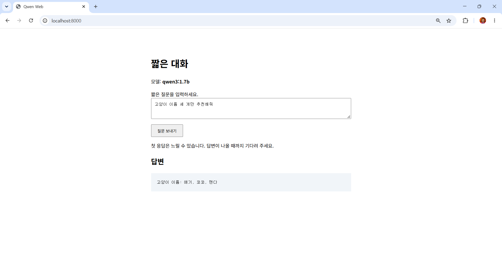

# 3주차 - 셸 스크립팅

> 교안: 02. 셸 스크립팅

## 학습 목표
- 반복적으로 쓰는 명령어를 셸 스크립트로 작성하고 실행
- 셸 스크립트의 권한, shebang, 경로 처리 방식 이해
- 환경 변수와 조건문으로 실행 환경 설정 및 오류 대응
- Ollama + Qwen 로컬 AI 서비스를 실행하며 자동화의 필요성 이해

## 배운 내용

### 1. 왜 셸 스크립트인가
- 매일 10분 걸리는 반복 작업 → 1년이면 약 61시간
- 사람은 오타, 순서 실수를 하지만 잘 작성된 스크립트는 항상 같은 결과

### 2. 로컬 AI 서비스 구조
```
브라우저 (localhost:8000)
   ↓ 질문
chat.py (파이썬 웹 앱, 127.0.0.1:8000)
   ↓ API 요청
Ollama 서버 (127.0.0.1:11434)
   ↓
qwen3 모델
```
- **Qwen**: 알리바바 클라우드의 대형 언어 모델
- **Ollama**: 로컬에서 LLM을 설치하고 실행하는 오픈소스 플랫폼
- 모델 크기의 `b` = Billion(10억) 파라미터. 클수록 성능은 좋아질 수 있지만 느리고 메모리를 많이 씀
- 모델은 Ollama가 따로 보관하므로 Git에 올리지 않음

### 3. 셸 스크립트 핵심 문법
| 문법 | 의미 |
|---|---|
| `#!/bin/bash` | shebang. 이 파일을 Bash로 실행하라고 OS에 알림 |
| `$0`, `$1`, `$#`, `$?` | 스크립트 이름, 첫 번째 인자, 인자 개수, 직전 명령의 종료 상태 |
| `$(명령)` | 명령어 치환. 명령 실행 결과를 그 자리에 넣음 |
| `cd "$(dirname "$0")"` | 어디서 실행하든 스크립트가 있는 폴더로 이동 |
| `\|\| exit 1` | 앞 명령이 실패하면 상태 코드 1로 종료 |
| `exec` | 현재 셸을 해당 프로그램으로 교체 (PID 유지) |
| `export` | 환경 변수를 자식 프로세스에 전달 |
| `<< 'EOF'` | heredoc. 여러 줄을 파일로 저장 (따옴표가 있으면 변수를 그대로 저장) |

- 종료 상태 **0 = 성공**, 0 이외 = 실패 (숫자 0을 거짓으로 보는 것과 반대라 주의)
- 표준 입출력: 0=stdin, 1=stdout, 2=stderr / `>/dev/null 2>&1`은 출력과 오류를 모두 버림

## 실습 과정

### Ollama 설치 및 모델 다운로드
```bash
curl -fsSL https://ollama.com/install.sh | sh
curl -fsS http://127.0.0.1:11434/api/tags   # 서버 응답 확인
ollama pull qwen3:0.6b
ollama pull qwen3:1.7b
ollama list
```
```
NAME          ID              SIZE      MODIFIED
qwen3:1.7b    8f68893c685c    1.4 GB    4 weeks ago
qwen3:0.6b    7df6b6e09427    522 MB    4 weeks ago
```

### start.sh 작성 및 실행
```bash
#!/bin/bash
cd "$(dirname "$0")" || exit 1
if ! command -v python3 >/dev/null 2>&1; then
        echo "Python3를먼저설치하세요." >&2
        exit 1
fi
exec python3 chat.py
```
| 줄 | 하는 일 |
|---|---|
| `#!/bin/bash` | 이 파일을 Bash로 실행 |
| `cd "$(dirname "$0")" \|\| exit 1` | 스크립트가 있는 폴더로 이동, 실패하면 종료 |
| `if ! command -v python3 ...` | python3가 없으면 |
| `echo "..." >&2` | 안내 메시지를 표준 오류로 출력 |
| `exit 1` | 실패 상태로 종료 |
| `exec python3 chat.py` | 현재 셸을 python3로 교체해 웹 앱 실행 |
```bash
./start.sh            # Permission denied
chmod u+x start.sh    # 실행 권한 부여
./start.sh
```

### 환경 변수로 설정 바꾸기 (start_with_export.sh)
```bash
#!/bin/bash
cd "$(dirname "$0")" || exit 1
export MODEL="qwen3:0.6b"
exec ./start.sh
```
- `export MODEL=...`로 사용할 모델을 지정한 뒤 start.sh 실행
- 이 스크립트 안에서만 적용되고, 원래 터미널의 환경 변수는 바뀌지 않음

### 실행 결과
<!-- 확인 필요: 브라우저 대화 화면 캡처 → images/에 저장 후 아래 경로 수정 -->


## 트러블슈팅
| 증상 | 원인 | 해결 |
|---|---|---|
| `Permission denied` | 실행 권한 없음 | `chmod u+x start.sh` |
| `command not found` (start.sh) | 현재 폴더는 PATH에 없음 | `./start.sh`로 실행 |

## 파일 설명
| 파일 | 설명 |
|---|---|
| `qwen-web/chat.py` | LMS에서 받은 파이썬 웹 앱 (표준 라이브러리만 사용) |
| `qwen-web/start.sh` | chat.py를 어디서든 실행하고, python3가 없으면 안내하는 스크립트 |
| `qwen-web/start_with_export.sh` | 환경 변수(MODEL)를 설정한 뒤 start.sh 실행 |

## 느낀 점

평소 온라인에서 제공하는 AI 서비스를 주로 사용했는데,
Qwen을 활용해 로컬 환경에서 직접 AI 모델과 대화해 보니 색다른 경험이었습니다.
