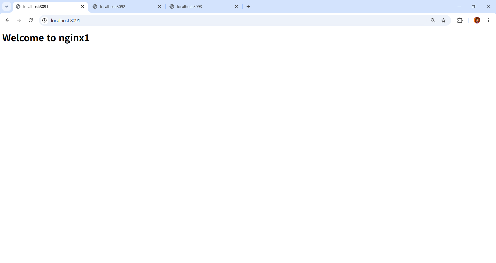
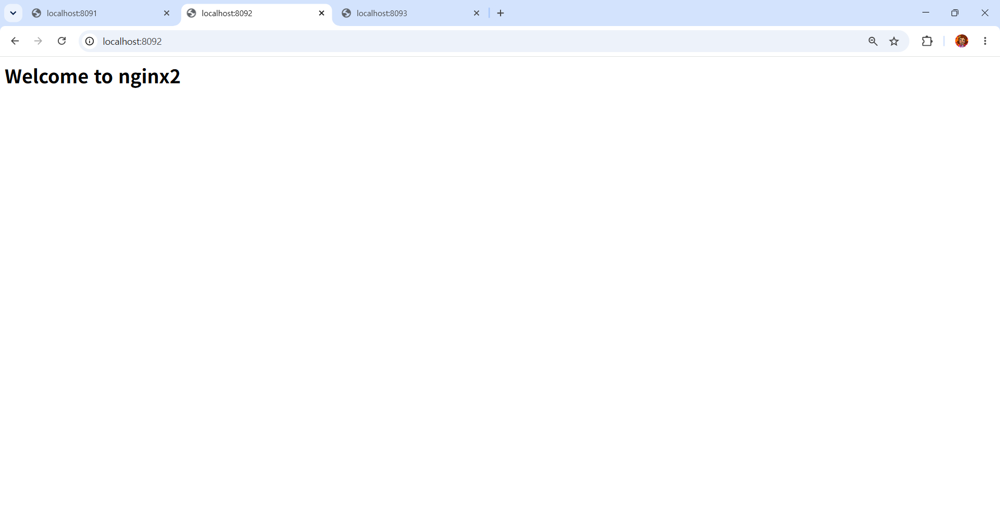
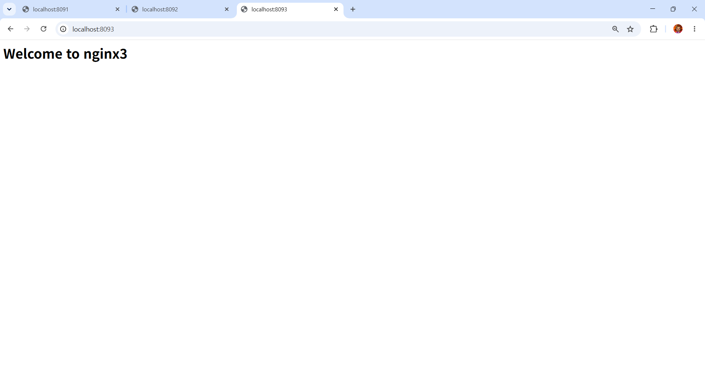
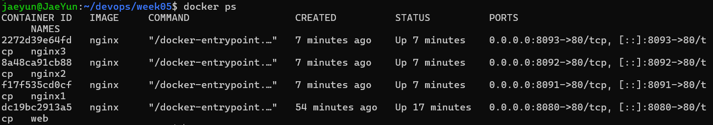

# 5주차 - Docker w/ GitHub Issue

> 교안: 05. 도커 w/ GitHub Issue

## 학습 목표
- 하이퍼바이저(VM)와 컨테이너의 차이 설명
- 이미지와 컨테이너의 관계 설명
- `docker run, ps, logs, exec, stop, rm, images` 사용
- 컨테이너로 서로 다른 실행 환경 만들기
- Issue → Branch → Pull Request → Merge로 실습 결과 기록

## 배운 내용

### 1. 왜 Docker인가
- "내 컴퓨터에서는 되는데요?" 문제: 파이썬 버전, OS, 라이브러리가 PC마다 다름
- Docker: 앱과 실행에 필요한 라이브러리, 설정을 **컨테이너**로 묶어 어디서든 비슷하게 실행

### 2. VM vs 컨테이너
| | 하이퍼바이저(VM) | 컨테이너 |
|---|---|---|
| OS | VM마다 Guest OS 필요 | 호스트 커널 공유 |
| 크기 | GB 단위 | MB 단위 |
| 시작 | 상대적으로 느림 | 빠름 |
| 격리 | 강함 | 프로세스 수준 |

- 격리 기술: **namespace**(안 보이게, PID/네트워크/마운트) + **cgroup**(많이 못 쓰게, CPU/메모리 제한)

### 3. 이미지와 컨테이너
- 이미지 = 붕어빵 틀 (읽기 전용), 컨테이너 = 붕어빵 (이미지로 N개 생성 가능)
- 컨테이너를 삭제하면 그 안에서 바꾼 내용(쓰기 계층)도 사라짐
- 레지스트리 = 이미지 창고 (Docker Hub, ghcr.io)

### 4. 이슈 기반 작업 흐름
```
Issue        → 무엇을, 왜 할 것인가 (완료 조건 체크박스)
Branch       → 작업을 안전하게 진행하는 공간
Pull Request → 변경 내용을 검토하고 합쳐 달라는 요청
Merge        → 반영 (PR 본문에 Close #번호 → 이슈 자동 종료)
```

## 실습 과정

### Docker 설치 확인
```bash
docker --version > docker-version.txt
docker info > docker-info.txt
docker run --rm hello-world > docker-run-hello-world.txt
```
결과 파일: [docker-version.txt](docker-version.txt), [docker-info.txt](docker-info.txt), [docker-run-hello-world.txt](docker-run-hello-world.txt)

### nginx 컨테이너 실행
```bash
docker run -d -p 8080:80 --name web nginx
curl -I http://localhost:8080 > curl-result.txt
docker ps > docker-ps.txt
```
- `-d`: 백그라운드 실행 / `-p 8080:80`: 호스트 8080 → 컨테이너 80 / `--name`: 컨테이너 이름
- nginx를 설치하지 않았는데 실행됨 → 이미지를 받아 컨테이너로 실행했기 때문
- 결과 파일: [curl-result.txt](curl-result.txt), [docker-ps.txt](docker-ps.txt)

### 컨테이너 안으로 들어가기
```bash
docker exec -it web bash
# echo "<h1>Hi</h1>" > /usr/share/nginx/html/index.html
# exit
docker rm -f web
docker run -d -p 8080:80 --name web nginx   # 다시 만들면 Hi가 사라짐
```

### 서로 다른 파이썬 버전 실행 (test.py, match-case 문법)
```bash
docker run --rm -v "$PWD:/app" -w /app python:3.9-slim python test.py
# SyntaxError: invalid syntax  (match-case는 3.10부터 지원)
docker run --rm -v "$PWD:/app" -w /app python:3.12-slim python test.py
# two
```
- 호스트에 파이썬 3.9, 3.12를 설치하지 않고도 버전별 테스트 가능

## 혼자서 해보기

### nginx 3개를 다른 포트로 실행 후 index.html 수정
```bash
docker run -d -p 8091:80 --name nginx1 nginx
docker run -d -p 8092:80 --name nginx2 nginx
docker run -d -p 8093:80 --name nginx3 nginx
docker exec -it nginx1 bash   # index.html 수정 (nginx2, nginx3도 동일)
```

### curl 결과
```bash
$ curl http://localhost:8091
<h1>Welcome to nginx1</h1>

$ curl http://localhost:8092
<h1>Welcome to nginx2</h1>

$ curl http://localhost:8093
<h1>Welcome to nginx3</h1>
```

### 브라우저 캡처




### docker ps


- 컨테이너 안의 포트는 모두 80이지만 충돌 없음 → 각 컨테이너가 자기만의 네트워크 공간을 가짐
- 단, 호스트 포트(8091, 8092, 8093)는 서로 달라야 함

## Issue → Merge 기록
| 단계 | 내용 |
|---|---|
| Issue | [#4](https://github.com/OMORI-Aubrey/DevOps/issues/4) 5주차 Docker 실행 환경 확인 및 nginx 실행 |
| Branch | `docs/#4-docker-start` |
| PR | [#5](https://github.com/OMORI-Aubrey/DevOps/pull/5) 5주차: Docker (본문 `Close #4`) |
| Merge 후 | PR #5 MERGED, Issue #4 자동 종료 (CLOSED) |

## 트러블슈팅

### WSL 2 환경에서 Docker 명령어 실행 오류
- 문제 상황: WSL 2 환경에서 docker run 명령어 실행 시 The command 'docker' could not be found in this WSL 2 distro. 오류가 발생함.
- 해결 방법: Docker Desktop을 재실행한 후 Docker 명령어를 다시 실행함.
- 해결 결과: docker run 명령어가 정상적으로 실행되어 문제가 해결됨.

## 느낀 점
Docker 이미지와 컨테이너를 직접 다뤄보면서 두 개념의 차이와 동작 방식을 이해할 수 있었습니다.
명령어를 통해 컨테이너를 실행하고 관리하는 과정을 실습해 보며 Docker의 활용 방법을 익힐 수 있어 좋았습니다.
