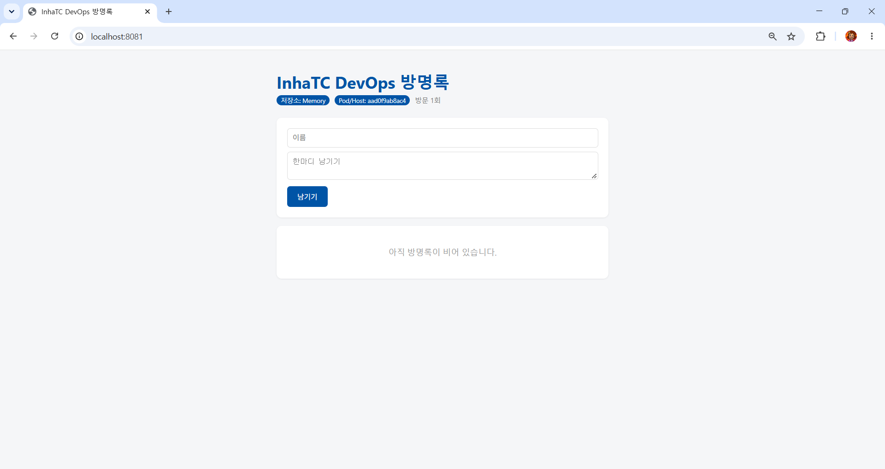

# 6주차 - Dockerfile

> 교안: 06. 도커파일
> 실습 코드: [../guestbook](../guestbook/) (태그 `week06`)

## 학습 목표
- Dockerfile 주요 명령어 설명 (FROM, WORKDIR, COPY, RUN, EXPOSE, CMD, ENV)
- 레이어 캐시 원리와 명령어 순서의 중요성 이해
- 앱을 이미지로 만들고 실행
- 내 이미지를 공유하고 친구 이미지를 받아 실행
- 멀티 아키텍처 빌드의 필요성 이해

## 배운 내용

### 1. Dockerfile
- 이미지를 만드는 **레시피**. 실행 환경을 코드로 정의 (Infrastructure as Code)
- 손으로 만들면 나만 알지만, 글로 적으면 누구나 몇 번이든 똑같이 만들 수 있음

| 명령어 | 의미 | 주의점 |
|---|---|---|
| FROM | 기반 이미지 | `-slim`, `-alpine`은 가벼운 버전 |
| WORKDIR | 작업 디렉터리 (없으면 생성) | `cd`와 비슷 |
| COPY | 호스트 파일 → 이미지 | 빌드 컨텍스트 기준 경로 |
| RUN | **빌드할 때** 실행 | 결과가 이미지에 남음 |
| ENV | 환경 변수 기본값 | `docker run -e`로 덮어쓰기 가능 |
| EXPOSE | 사용할 포트 **문서화** | 실제로 열리지 않음, `-p` 필요 |
| CMD | **컨테이너 시작할 때** 실행 | 마지막 것만 유효 |

### 2. 레이어 캐시
- 각 명령이 레이어가 되고, 바뀌지 않은 레이어는 캐시 재사용
- 한 레이어가 바뀌면 **그 아래 레이어는 전부 다시 빌드**
- 그래서 자주 안 바뀌는 `requirements.txt`를 먼저 복사하고 `pip install`, 자주 바뀌는 코드(`COPY . .`)는 뒤에

### 3. 설정을 넣는 세 가지 방법
| 방법 | 언제 확정 | 바꾸려면 |
|---|---|---|
| app.py 기본값 | 코드 | 코드 수정 후 재빌드 |
| Dockerfile ENV | 이미지 빌드 시점 | 재빌드 |
| `docker run -e` | 컨테이너 실행 시점 | 컨테이너만 다시 실행 |

우선순위: **코드 기본값 < Dockerfile ENV < docker run -e**

### 4. 이미지 주소 읽기
```
ghcr.io / omori-aubrey / guestbook : v1
레지스트리   사용자          이미지 이름   태그
```
- 레지스트리를 생략하면 Docker Hub
- 태그를 생략하면 `latest`를 요청 (가장 최신을 찾아주는 게 아님)

## 실습 과정

### Dockerfile 한 줄씩 설명
```dockerfile
FROM python:3.12-slim
WORKDIR /app
COPY requirements.txt .
RUN pip install --no-cache-dir -r requirements.txt
COPY . .
RUN useradd -m appuser
USER appuser
ENV APP_TITLE="InhaTC DevOps 방명록" \
    THEME_COLOR="#0054A6"
EXPOSE 5000
CMD ["python", "app.py"]
```
| 줄 | 하는 일 |
|---|---|
| `FROM python:3.12-slim` | 파이썬 3.12가 설치된 가벼운 이미지에서 시작 |
| `WORKDIR /app` | 이후 명령을 /app 폴더에서 실행 (없으면 생성) |
| `COPY requirements.txt .` | 라이브러리 목록만 먼저 복사 → 코드가 바뀌어도 아래 설치 단계는 캐시 재사용 |
| `RUN pip install --no-cache-dir -r requirements.txt` | Flask, redis 설치 (빌드할 때 한 번). `--no-cache-dir`로 이미지 크기 절약 |
| `COPY . .` | 나머지 코드 복사 (자주 바뀌므로 뒤쪽에) |
| `RUN useradd -m appuser` | root가 아닌 일반 사용자 생성 |
| `USER appuser` | 이후 컨테이너를 그 사용자로 실행 (root 실행은 위험) |
| `ENV APP_TITLE=... THEME_COLOR=...` | 제목과 테마 색 기본값을 이미지에 저장 (`-e`로 덮어쓰기 가능) |
| `EXPOSE 5000` | 5000번 포트를 쓴다는 문서화 (실제로 열려면 `-p` 필요) |
| `CMD ["python", "app.py"]` | 컨테이너를 켤 때마다 앱 실행 |

### 빌드 및 실행
```bash
cd ~/devops/guestbook
docker build -t guestbook:v1 .
docker run -d -p 8081:5000 --name gb guestbook:v1
```



### 캐시 확인
```bash
docker build -t guestbook:v1.1 .
```
```
[+] Building 0.3s (11/11) FINISHED
 => [1/6] FROM docker.io/library/python:3.12-slim@sha256:f77ac9e4...
 => CACHED [2/6] WORKDIR /app
 => CACHED [3/6] COPY requirements.txt .
 => CACHED [4/6] RUN pip install --no-cache-dir -r requirements.txt
 => CACHED [5/6] COPY . .
 => CACHED [6/6] RUN useradd -m appuser
 => => naming to docker.io/library/guestbook:v1.1
```
- 바뀐 파일이 없어서 모든 단계가 `CACHED` → 빌드가 0.3초 만에 끝남
- 코드 파일 하나만 바꾸면 `[5/6] COPY . .`부터 다시 빌드되고, `pip install`은 그대로 캐시 사용
- 반대로 `COPY . .`를 `pip install`보다 앞에 두면 코드 한 줄만 고쳐도 `pip install`을 매번 다시 실행

### ghcr.io에 이미지 공유 (GitHub CLI 연동)
```bash
gh auth token | docker login ghcr.io -u OMORI-Aubrey --password-stdin
docker tag guestbook:v1 ghcr.io/omori-aubrey/guestbook:v1
docker push ghcr.io/omori-aubrey/guestbook:v1
```
- GitHub 패키지 페이지에서 Public으로 변경해야 다른 사람이 받을 수 있음
- 내 이미지 주소: `ghcr.io/omori-aubrey/guestbook:v1`


### 친구 이미지
- 친구 코드도 없고 Flask도 설치 안 했는데 내 PC에서 실행됨 → 실행 환경이 이미지에 들어 있기 때문
- 방명록 글은 공유되지 않음 → 이미지는 프로그램을 공유하는 것이지 데이터를 공유하지 않음

## 트러블슈팅
| 증상 | 원인 | 해결 |
|---|---|---|
| `repository name (OMORI-Aubrey/guestbook) must be lowercase` | 이미지 이름은 소문자만 허용 | `ghcr.io/omori-aubrey/guestbook:v1`로 소문자 사용 (로그인 아이디는 그대로 가능) |

## 생각해보기
- 컨테이너를 재시작하면 방명록 글이 사라짐 → 글이 프로세스 메모리에 저장되기 때문
- 데이터를 남기려면 DB나 볼륨처럼 컨테이너 밖에 저장해야 함 → 7주차로 이어짐

## 느낀 점
다른 사람과 이미지를 쉽게 공유할 수 있는 기능에 대해 알게되어 좋았습니다.
앞으로도 활용할 일이 많을 것 같습니다.
