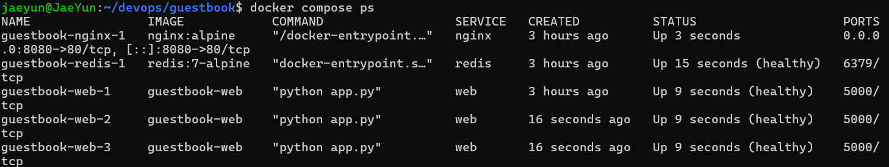
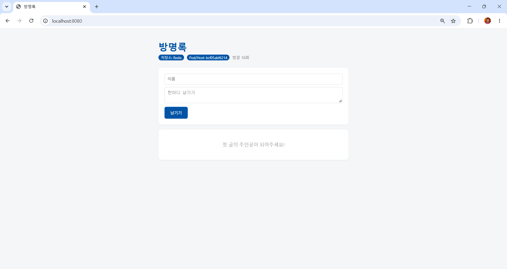

# 7주차 - Docker Compose

> 교안: 07. 도커 컴포즈
> 실습 코드: [../guestbook](../guestbook/) (`compose.yaml`, `nginx.conf`, `.env.example`)

## 학습 목표
- 여러 컨테이너를 함께 띄워야 하는 이유 설명
- 컨테이너끼리 서비스 이름으로 통신하는 원리 설명
- 볼륨의 필요성과 동작 설명
- compose.yaml 작성 및 docker compose 명령어 사용
- 환경 변수로 컨테이너 간 정보 주입, 컴포즈 구성 다듬기

## 배운 내용

### 1. 컨테이너 하나 = 역할 하나
- 6주차 문제: 컨테이너를 재시작하면 방명록 글이 사라짐 (메모리 저장)
- 해결: 앱(web)과 DB(redis)를 **각각 다른 컨테이너**로 띄우고 연결
- 앱과 DB를 한 컨테이너에 넣으면 앱만 업데이트해도 DB가 재시작되고, 따로 확장하기 어려움

### 2. Docker Compose
- 여러 컨테이너의 구성을 `compose.yaml` 파일 하나에 정의하고 한 번에 실행·관리하는 도구
- 비유: 각 악기(컨테이너)를 악보(compose.yaml)대로 함께 연주

| docker run | compose.yaml |
|---|---|
| `-p 8080:5000` | `ports: ["8080:5000"]` |
| `-e KEY=value` | `environment: {KEY: value}` |
| `-v data:/path` | `volumes: [data:/path]` |

### 3. 서비스 이름 = DNS 주소
- 컴포즈가 네트워크를 만들고 서비스 이름을 내부 DNS에 등록
- `REDIS_HOST: "redis"`처럼 IP 대신 이름을 쓰면, IP가 바뀌어도 상관없음

### 4. 최종 구성
```
브라우저 :8080
     │
 [ nginx ]          요청을 받아 web에 나눠줌 (리버스 프록시 + 로드 밸런싱)
     │
 [web] [web] [web]  --scale web=3, healthcheck
     │
 [ redis ]          데이터 저장, 비밀번호는 .env에서
```

## 실습 과정

### 1. 실행 및 상태 확인
```bash
docker compose up -d
docker compose ps
```
```
NAME                IMAGE            SERVICE   STATUS                        PORTS
guestbook-nginx-1   nginx:alpine     nginx     Up About a minute             0.0.0.0:8080->80/tcp, [::]:8080->80/tcp
guestbook-redis-1   redis:7-alpine   redis     Up About a minute (healthy)   6379/tcp
guestbook-web-1     guestbook-web    web       Up About a minute (healthy)   5000/tcp
```
- redis, web 모두 **healthy**
- nginx만 `0.0.0.0:8080`으로 외부에 열려 있고, redis(6379)와 web(5000)은 내부에서만 사용
- nginx는 healthcheck를 설정하지 않아 상태 표시가 없음


### 2. 데이터 유지 확인 (볼륨)
| 명령 | 결과 | 이유 |
|---|---|---|
| `docker compose restart web` | 글 유지 | 데이터는 web이 아니라 redis에 있음 |
| `docker compose down` → `up -d` | 글 유지 | 컨테이너, 네트워크만 삭제. 볼륨은 남음 |
| `docker compose down -v` → `up -d` | 글 사라짐 | `-v`는 볼륨까지 삭제 |

- 운영 환경에서 `down -v`를 잘못 실행하면 데이터가 날아가므로 주의

### 3. 네트워크 격리
```bash
$ python3 -c "import socket; socket.create_connection(('127.0.0.1', 6379), timeout=2)"
ConnectionRefusedError: [Errno 111] Connection refused

$ docker compose exec web python -c "import socket; print(socket.gethostbyname('redis'))"
172.18.0.2

$ docker compose exec web python -c "import socket; socket.create_connection(('redis', 6379), 2); print('TCP 연결 성공')"
TCP 연결 성공
```
- 호스트에서는 redis에 접속 불가 (`ports:`가 없어서 공개 안 됨)
- 같은 네트워크의 web에서는 `redis`라는 이름이 `172.18.0.2`로 해석되어 연결 성공
- 앱만 열고 DB는 내부에서만 접근 → 불필요한 외부 접근 경로를 줄이는 보안 설계

### 4. .env로 비밀번호 분리
```yaml
REDIS_PASSWORD: "${REDIS_PASSWORD:?비밀번호 설정 필요}"
```
- `.env`(실제 값)는 `.gitignore`로 제외, `.env.example`(양식)만 Git에 올림
- `:?메시지`: 값이 비어 있으면 오류 메시지와 함께 중단

**.env를 Git에 올리지 않는 이유**
- 공개 저장소에 올리면 비밀번호가 전 세계에 공개됨
- 나중에 파일을 지워도 Git 이력에 남을 수 있음
- 설정 파일(compose.yaml)은 Git에, 비밀 값(.env)은 Git 밖에

### 5. healthcheck
- `depends_on`만 쓰면 redis가 **시작**되면 web을 띄움 → 아직 준비 안 된 redis에 연결 실패할 수 있음
- `condition: service_healthy`를 쓰면 redis가 **준비 완료(healthy)** 된 뒤 web 시작
- 시작과 준비 완료는 다름 (식당이 문을 열었다고 바로 주문을 받을 수 있는 건 아님)

### 6. scale + nginx
```bash
$ docker compose up -d --scale web=3
 ✔ Container guestbook-redis-1 Healthy
 ✔ Container guestbook-nginx-1 Running
 ✔ Container guestbook-web-1   Healthy
 ✔ Container guestbook-web-3   Healthy
 ✔ Container guestbook-web-2   Healthy

$ docker ps --format "{{.ID}} {{.Names}}"
425703707c46 guestbook-web-2
ec4b74742515 guestbook-web-3
161a1e9594cd guestbook-nginx-1
f0600a0ec529 guestbook-web-1
60e4a5d97ead guestbook-redis-1
```
- 브라우저에서 새로고침할 때마다 Pod/Host 이름이 바뀜 → 서로 다른 web이 응답
- 어느 web으로 가도 같은 글이 보임 → 데이터는 redis 하나에 있기 때문
- web마다 `ports: "8080:5000"`이 있으면 `port is already allocated` 오류 → web은 `expose`만, 바깥 포트는 nginx 하나만



### 7. web 하나를 멈추면? (호기심)
```bash
$ docker stop guestbook-web-2
$ docker compose ps
guestbook-nginx-1   ...   Up 3 minutes
guestbook-redis-1   ...   Up 3 minutes (healthy)
guestbook-web-1     ...   Up 3 minutes (healthy)
guestbook-web-3     ...   Up 2 minutes (healthy)

$ for i in 1 2 3 4 5 6; do curl -s -o /dev/null -w "%{http_code} " localhost:8080; done
200 200 200 200 200 200
```
- 남은 web 2개가 응답해서 서비스는 유지됨
- 시간이 지나도 web-2는 **스스로 살아나지 않음**
  - `restart: unless-stopped`가 있어도 `docker stop`으로 사람이 직접 멈춘 컨테이너는 재시작하지 않음
- 다시 3개로 만들려면 사람이 직접 입력해야 함
```bash
$ docker compose up -d --scale web=3
$ docker compose ps
guestbook-web-2   ...   CREATED 3 minutes ago   Up 8 seconds (healthy)
```
- web-2의 CREATED는 3분 전, Up은 8초 → 새로 만든 게 아니라 멈춰 있던 컨테이너를 다시 시작한 것

### 8. config 검사와 watch
```bash
docker compose config --quiet && echo OK   # 띄우기 전에 YAML 검사
docker compose watch --no-up               # 파일 변경 감시
```
- `templates/index.html` 문구를 바꾸자마자 자동으로 rebuild되어 반영됨

## 트러블슈팅
| 증상 | 원인 | 해결 |
|---|---|---|
| `required variable REDIS_PASSWORD is missing a value` | 해당 폴더에 `.env`가 없음 | `.env` 생성, 또는 일회성으로 `REDIS_PASSWORD=x docker compose down` |
| `git status`에 `guestbook/.env`가 Untracked로 보임 | `.gitignore`에 `.env`가 없음 | `echo ".env" >> .gitignore` 후 다시 확인 |
| 같은 앱 폴더가 `guestbook`, `guestbook-week07` 두 개 | 주차별로 복사함 | `diff -rq`로 비교 후 `guestbook`으로 통합, `git rm -r guestbook-week07` |

## 느낀 점
Docker Compose를 활용해 여러 컨테이너를 설정하고 한 번에 관리하는 방법을 배울 수 있었습니다.
개별적으로 컨테이너를 실행하는 것보다 효율적으로 관리할 수 있다는 점이 인상적이었습니다.
