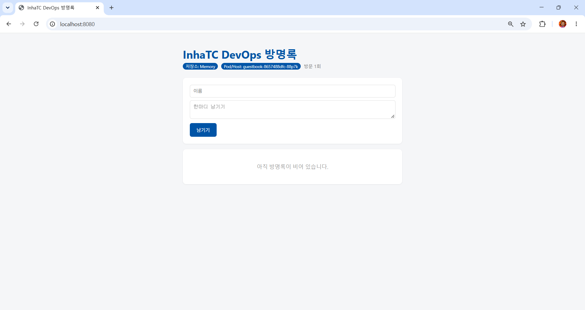

# 9주차 - 쿠버네티스

> 교안: 08. 쿠버네티스

## 학습 목표

- minikube를 설치·기동하고 `kubectl get nodes`로 Ready 상태를 확인한다.
- 도커 컴포즈의 한계와 오케스트레이션이 필요한 이유를 설명한다.
- 선언형과 명령형의 차이를 설명한다.
- kubectl 기본 명령어(get / describe / logs / exec / delete)를 사용한다.
- 6주차에 만든 방명록 이미지를 쿠버네티스에서 실행한다.

## 배운 내용

### 왜 쿠버네티스인가

| 도구 | 범위 | 한계 |
|---|---|---|
| docker run | 컨테이너 하나씩 | 여러 개 관리는 사람이 직접 |
| docker compose | 컨테이너 여러 개, 컴퓨터 1대 | 다른 서버로 재배치, 자동 확장, 무중단 배포 없음 |
| Kubernetes | 컨테이너 수백 개, 서버 수십 대 | 배울 것과 관리할 것이 많음 |

### 명령형 vs 선언형

| 구분 | 명령형 | 선언형 |
|---|---|---|
| 말하는 방식 | "이렇게 해라" (어떻게) | "이런 상태를 원한다" (무엇을) |
| 예시 | `docker run` 3번 | `replicas: 3` |
| 컨테이너가 죽으면 | 사람이 다시 run | 쿠버네티스가 알아서 다시 만듦 |

선언형 한 줄 정리: 상품이 떨어질 때마다 채우는 대신 각 칸에 항상 10개씩 있도록 기준을 정해 두면 부족한 수량을 보충하듯, 원하는 개수만 적어 두면 쿠버네티스가 계속 세어 보면서 맞춰 준다.

**조정 루프(reconciliation loop)**: 관찰(지금 몇 개?) → 비교(원하는 건 몇 개?) → 조치(차이만큼 생성/삭제) → 다시 관찰

### 클러스터 구성

| 구성 요소 | 하는 일 |
|---|---|
| API Server | kubectl 요청을 받는 창구 |
| etcd | 클러스터의 모든 상태를 저장하는 DB |
| Scheduler | 새 Pod를 어느 노드에 둘지 결정 |
| Controller | 원하는 상태와 현재 상태를 비교해 맞춤 |
| Node | 컨테이너가 실제로 도는 서버 (minikube에선 도커 컨테이너 1개) |
| kubelet | 노드에서 Pod를 실제로 띄우고 상태 보고 |
| Pod | 컨테이너를 감싼 최소 배포 단위 (이번 실습은 Pod 1개 = 컨테이너 1개) |

kubectl은 컨테이너를 직접 띄우지 않고 API Server에 "원하는 상태"를 등록만 하고, 실제 실행은 kubelet이 한다.

### kubectl run vs Deployment

| 상황 | `kubectl run` Pod | Deployment Pod |
|---|---|---|
| 컨테이너 비정상 종료 | 재시작 | 재시작 |
| Pod 자체 삭제 | 복구 안 됨 | 새 Pod 생성 |
| 개수 유지 | 불가 | 가능 |

Deployment → ReplicaSet → Pod 구조이며, Pod 이름 `mynginx-668c4f948b-cltbz`는 `Deployment이름-ReplicaSet해시-무작위`이다. 새로 생긴 Pod는 이름 끝이 달라서 "되살린 것"이 아니라 "새로 만든 것"이고, 그래서 Pod 안에 저장한 데이터는 사라진다.

### docker vs kubectl

| docker | kubectl |
|---|---|
| `docker ps` | `kubectl get pods` |
| `docker inspect web` | `kubectl describe pod web` (Events 확인) |
| `docker logs web` | `kubectl logs web` |
| `docker exec -it web sh` | `kubectl exec -it web -- sh` |
| `docker run -p 8080:80` | `kubectl port-forward web 8080:80` (확인용) |
| `docker rm -f web` | `kubectl delete pod web` |

### 네임스페이스와 컨텍스트

- 네임스페이스: 클러스터 안의 칸막이. 안 보이면 `-A`로 전체 확인
- 컨텍스트: 지금 어느 클러스터에 명령하는지. 명령 전 `kubectl config current-context` 확인 습관

## 실습 과정

### 1. 설치 및 클러스터 기동 (minikube)

```bash
$ kubectl version --client
$ minikube start --driver=docker --memory=2048 --cpus=2
$ minikube status
$ kubectl get nodes
NAME       STATUS   ROLES           AGE   VERSION
minikube   Ready    control-plane   51m   v1.37.0
```

### 2. 클러스터 탐색

```bash
$ kubectl config current-context    # minikube
$ kubectl get pods -A               # kube-system 구역의 시스템 Pod들
```

### 3. 첫 Pod

```bash
$ kubectl run mynginx --image=nginx
$ kubectl get pods
$ kubectl describe pod mynginx      # 맨 아래 Events 확인
$ kubectl exec -it mynginx -- bash
$ kubectl port-forward mynginx 8080:80
```

### 4. 자가 치유

```bash
$ kubectl delete pod mynginx        # run으로 만든 Pod는 복구 안 됨
$ kubectl create deployment mynginx --image=nginx --replicas=3
$ kubectl get pods -w               # 다른 터미널에서 Pod 하나 delete
NAME                       READY   STATUS    RESTARTS   AGE
mynginx-668c4f948b-czbj5   1/1     Running   0          103s
mynginx-668c4f948b-l5rg6   1/1     Running   0          103s
mynginx-668c4f948b-t4rhd   1/1     Running   0          103s
mynginx-668c4f948b-czbj5   1/1     Terminating   0          2m27s
mynginx-668c4f948b-r8dcq   0/1     Pending       0          0s
mynginx-668c4f948b-czbj5   1/1     Terminating   0          2m27s
mynginx-668c4f948b-r8dcq   0/1     Pending       0          0s
mynginx-668c4f948b-r8dcq   0/1     ContainerCreating   0          0s
mynginx-668c4f948b-czbj5   0/1     Completed           0          2m28s
mynginx-668c4f948b-r8dcq   0/1     ContainerCreating   0          1s
mynginx-668c4f948b-czbj5   0/1     Completed           0          2m28s
mynginx-668c4f948b-czbj5   0/1     Completed           0          2m28s
mynginx-668c4f948b-r8dcq   1/1     Running             0          2s
$ kubectl get deploy,rs,pods
```

### 5. 내 방명록 이미지 배포

```bash
$ kubectl delete deployment mynginx
$ kubectl create deployment guestbook --image=ghcr.io/omori-aubrey/guestbook:v1
$ kubectl get pods
$ kubectl port-forward deployment/guestbook 8080:5000
```

브라우저에서 `http://localhost:8080` 접속 결과 (Pod/Host 배지에 Pod 이름 표시)




Pod를 삭제하면 새 Pod는 자동 생성되지만 port-forward 연결은 끊기고, 저장소가 Memory라 방명록 데이터도 사라진다. (안정적인 접속 경로는 다음 주 Service)

### 6. 정리

```bash
$ kubectl delete deployment guestbook
$ minikube stop
```

## 트러블슈팅

| 증상 | 원인 | 해결 |
|---|---|---|
| nginx Pod가 Running인데 브라우저에서 `http://localhost:8080` 접속 안 됨 | 내 노트북과 Pod를 연결하는 통로가 없음 (Pod는 클러스터 안에서만 동작) | `kubectl port-forward mynginx 8080:80`로 노트북 8080 → Pod 80 연결 후 다시 접속 |
| port-forward 실행 후 터미널에 아무것도 입력할 수 없음 | port-forward가 연결을 유지하는 동안 터미널을 점유함 | 다른 터미널에서 작업하고, 끝나면 `Ctrl + C`로 종료 |

## 파일 설명

| 파일 | 설명 |
|---|---|
| week09/README.md | 9주차 실습 기록 (이번 주는 guestbook 코드 변경 없음) |
| week09/images/guestbook-k8s.png | 쿠버네티스에서 실행한 방명록 브라우저 화면 |

## 느낀 점

지난 시간에 web 3개를 유지하기 위해서 감시자 스크립트를 만들었던 기억이 있는데, 이렇게 쉽고 간단하게 할 수 있는 방법이 있어 놀라웠습니다. 
